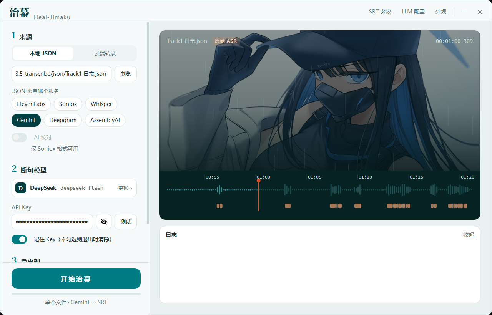

# Hiromaku（治幕 · 新界面版）

> 基于 [fuxiaomoke/heal-jimaku](https://github.com/fuxiaomoke/heal-jimaku) 的分支。原版功能全部保留，在这个基础上重做了整套界面（PyQt6），并修复、增强了若干转录解析问题。

[](https://www.apache.org/licenses/LICENSE-2.0) [](https://www.python.org/downloads/) [](https://riverbankcomputing.com/software/pyqt/)

**Hiromaku**（原名 Heal-Jimaku / 治幕）是一款桌面字幕优化工具：把 Whisper、Deepgram、AssemblyAI、Soniox、ElevenLabs、Gemini 等语音转录工具产出的**词级时间戳 JSON**，通过大语言模型按语义智能断句，转换成自然、易读的 **SRT 字幕文件**。开发初衷是"治愈"那些断句糟糕、难以阅读编辑的同人音声转录结果。



*新版界面：左侧为来源 / 断句模型 / 导出流程，右侧为字幕预览放映区，支持波形播放与逐条字幕定位。*

---

## ⚠️ 先看这里：「免费获取JSON」已失效（上游已知问题）

ElevenLabs 从 2026 年 10 月起给免费转录接口加了人机验证（hCaptcha）。治幕是 PyQt 桌面程序，没有浏览器内核，拿不到验证令牌，所以**内置的「免费获取JSON」在当前版本就是用不了的**——它不是 bug，重装或等更新都不会好。

**其余功能都正常**，包括这个程序最主要的用法：

- **已有 JSON 的断句、优化、导出**：Whisper、Deepgram、AssemblyAI、Soniox、ElevenLabs 官方 API、Gemini Transcribe 等工具产出的 JSON，拖进来照常处理；
- **ElevenLabs 官方 API**：填自己的 API Key，走官方付费通道；
- **Soniox 云端转录**：台本辅助、说话人分离都正常。

需要免费转录的，可以用上游作者的另一个项目 [mai2srt](https://github.com/fuxiaomoke/mai2srt)，或其它 ASR 工具先生成 JSON 再导入。

## ✨ 本分支相对于上游的改动

### 🎨 全新现代界面

- **主窗口整体重设计**：纸面浅色底、白色圆角卡片、衬线标题、青色主按钮，配色和字体全部收敛到统一的设计令牌
- **所有对话框一起换皮**：SRT 参数、LLM 高级设置、背景设置、云端转录、免费转录、台本/专有名词编辑弹窗，以及全局 QMessageBox、下拉菜单、悬浮提示，风格完全一致
- **字幕预览放映区**：右侧可实时预览 JSON / SRT 的解析结果并播放对应音频，断句效果所见即所得
- 勾选框统一为开关样式、下拉/箭头图标适配浅色背景、字号收敛到 10–12pt
- **随时可切回旧界面**：设置环境变量 `HEAL_JIMAKU_LEGACY_UI=1`；新界面构建失败时也会自动回退到旧界面，不影响使用

### 🔧 转录解析增强

- **新增 Gemini Transcribe JSON 格式**：读取逐词时间戳和说话人，日文/中文按语种正确拼接全文（不会出现「起き ちゃっ た」式多余空格），语言码自动归一化（`ja-JP` → `ja`）以命中对应语言的断句提示词
- **格式自动识别**：选错 JSON 格式也没关系，识别到特征（如顶层 `"app": "Gemini Transcribe"`）会自动按正确格式解析
- **修复 LLM 断句失败导致漏段**的问题；转录失败的分块会在日志中提示对应时段可能缺字幕
- **动态设置 `max_tokens`**：引入模型输出 token 上限查表，防止 LLM 输出被截断
- **多说话人处理、对白检测与上传进度追踪**
- **思考模式（Thinking Mode）支持**，适配 gpt-5.1/5.2、o1/o3/o4 等 reasoning 模型的调用
- Soniox 默认转录模型更新到 v5

### 🖱️ 交互改进

- **云端转录对话框支持拖拽**：音视频直接拖进整个对话框即可选中，支持多文件、整个文件夹（自动取第一层全部音视频），与「浏览」按钮行为一致
- 支持格式补全：mp3 wav flac m4a ogg opus aac webm mp4 mov
- 背景设置：自定义图片路径缺失时显示红框提示
- 大量对话框代码重构精简（约 -600 行冗余）

## 🚀 从源码运行

### 环境

- Windows，Python 3.8+
- 一个大语言模型 API Key（默认 [DeepSeek](https://platform.deepseek.com/)，可在 LLM 高级管理里配置 OpenAI / Claude / Gemini 等其它格式）
- 可选：[Soniox](https://soniox.com/) / [ElevenLabs](https://elevenlabs.io/) API Key（使用云端转录时）

### 步骤

```bash
git clone https://github.com/sananisome/Hiromaku.git
cd Hiromaku

python -m venv venv
venv\Scripts\activate

pip install -r requirements.txt
```

然后任选其一启动：

- **双击 `run-windows.bat`**（推荐，报错时窗口会保留日志）
- 或命令行运行：

  ```bash
  python src\main.py
  ```

### 切回旧界面（上游原版样式）

```bat
set HEAL_JIMAKU_LEGACY_UI=1
python src\main.py
```

## 📖 功能一览

继承自上游的核心功能（详细说明见 [USAGE.md](docs/USAGE.md)）：

| 功能 | 说明 |
|---|---|
| **语义断句** | LLM 两阶段处理（先生成全文摘要把握上下文，再分块断句），支持中/日/英/韩优化的提示词 |
| **多格式 JSON 输入** | ElevenLabs、Soniox、Whisper、Deepgram、AssemblyAI、Gemini，选错格式会自动纠正 |
| **云端转录** | ElevenLabs 官方 API、Soniox API（ElevenLabs 免费入口已失效，见上文） |
| **台本辅助转录** | Soniox 模式下导入 TXT / Word / PDF 台本，LLM 自动清洗拟声词、环境音、动作指示后作为 Context，提升专有名词识别率 |
| **SRT 参数自定义** | 最小/最大时长、每行最大字符数、字幕间隙 |
| **LLM 多配置管理** | 自定义 API 地址、模型、温度，支持 OpenAI / Claude / Gemini 显式格式，多配置一键切换 |
| **批量 & 拖拽** | 批量处理多个文件，全流程拖拽操作 |
| **Soniox AI 后处理** | 大模型二次校对，修正发音相似导致的错别字 |
| **配置持久化** | API 配置、路径、参数、背景图全部记忆；崩溃日志写入 `.heal_jimaku/logs/` |

## ⚙️ 配置文件

首次保存设置后，配置存放在用户主目录下：

```
~/.heal_jimaku/
├── config/config.json    # LLM 配置、SRT 参数、路径记忆等
└── logs/                 # 崩溃日志
```

## 🗺️ 后续计划

- [ ] 界面细节继续打磨（布局间距、深色模式）
- [ ] 双声道音频分轨处理与合并
- [ ] 时间轴手动调整

## 🤝 贡献

欢迎提 Issue 和 PR。 fork 自用也随意，Apache-2.0 授权。

## 📄 开源许可

本项目基于 [Apache License 2.0](LICENSE) 开源。

## 🙏 致谢

- 感谢原作者 [@fuxiaomoke](https://github.com/fuxiaomoke) 的 [heal-jimaku](https://github.com/fuxiaomoke/heal-jimaku)，本分支的全部核心功能都来自它
- 感谢 [DeepSeek](https://www.deepseek.com/) 提供的强大语言模型支持
- 感谢 [ElevenLabs](https://elevenlabs.io/)、[Soniox](https://soniox.com/)、[OpenAI (Whisper)](https://openai.com/research/whisper)、[Deepgram](https://deepgram.com/)、[AssemblyAI](https://www.assemblyai.com/)、Google [Gemini](https://ai.google/) 等提供的语音转录服务
- 感谢 [小红书 hi lab](https://github.com/rednote-hilab) 开源的高质量 OCR 模型
- 感谢 [LINUX DO](https://linux.do/) 的佬友们提供的各种大模型公益 API
- 感谢 [PyQt](https://riverbankcomputing.com/software/pyqt/) 开发团队
